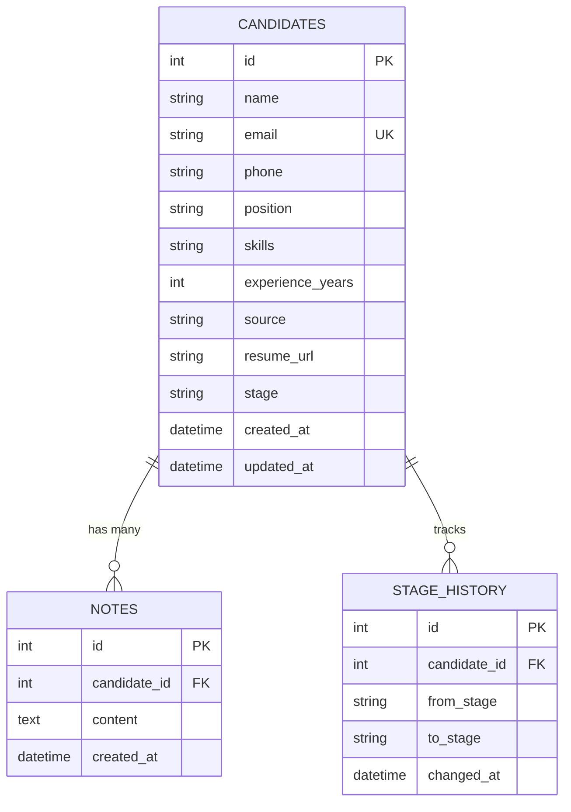

# TalentFlow ATS — Mini Applicant Tracking System

A full-stack, production-ready Mini Applicant Tracking System (ATS) designed for modern hiring teams to manage candidates, track pipeline progression, and analyze recruitment metrics. Built with a lightweight, high-performance Node.js/Express SQLite backend and an interactive, responsive React (Vite) single-page application.

> **Live Application Demo**: `[Insert Live Demo URL here]`  
> **GitHub Repository**: `[Insert GitHub Repository URL here]`  
> **Walkthrough / Demo Video**: `[Insert Loom / YouTube Demo Link here]`

---

## Table of Contents

1. [Overview & Highlights](#overview--highlights)
2. [Key Features](#key-features)
3. [Tech Stack & Architecture Decisions](#tech-stack--architecture-decisions)
4. [Folder Structure](#folder-structure)
5. [Data Model & Schema](#data-model--schema)
6. [API Reference Table](#api-reference-table)
7. [Getting Started Locally](#getting-started-locally)
   - [Prerequisites](#prerequisites)
   - [1. Backend Setup](#1-backend-setup)
   - [2. Frontend Setup](#2-frontend-setup)
   - [3. Auto-Seeding & Demo Data](#3-auto-seeding--demo-data)
8. [Deployment Guide](#deployment-guide)
   - [Deploying Backend to Render](#deploying-backend-to-render)
   - [Deploying Frontend to Vercel](#deploying-frontend-to-vercel)
9. [Assumptions](#assumptions)
10. [Known Limitations](#known-limitations)
11. [Future Improvements](#future-improvements)

---

## Overview & Highlights

TalentFlow ATS eliminates recruiting bottlenecks with an intuitive recruitment pipeline:
- **Instant Visual Analytics**: Executive dashboard with recruiting KPIs, Recharts bar charts, attribution donut chart, and stage-by-stage conversion funnel analysis.
- **Searchable Candidates Directory**: Multi-field 300ms debounced search, stage/position filtering, experience/applied date sorting, and pagination with URL query parameter synchronization.
- **Kanban Board with Drag & Drop**: Visual stage pipeline powered by `@hello-pangea/dnd` with optimistic UI updates and automated rollback on network failure.
- **Detailed Candidate Profiles**: Visual timeline of stage transitions, stage change dropdowns, and timestamped recruiter notes (newest first).
- **Zero ORM Overhead**: SQLite queries executed via `better-sqlite3` with Write-Ahead Logging (WAL) and foreign keys enabled.

---

## Key Features

### 1. Recruiting Analytics Dashboard (`/dashboard` & `/`)
- **5 Core KPI Cards**: Total Candidates, New Candidates This Week, In Interview, Hired, and Rejected.
- **Stage Distribution Bar Chart**: Recharts bar visualization showing candidate count per hiring stage.
- **Conversion Funnel**: Step-by-step pass-through rates and top-of-funnel conversion percentages across `APPLIED -> SCREENING -> INTERVIEW -> OFFER -> HIRED`.
- **Source Attribution Donut Chart**: Proportional breakdown of hiring channels (LinkedIn, Referral, Indeed, GitHub, Website, etc.).
- **Top Positions Bar Chart**: Demand distribution across engineering, design, and management openings.
- **Recent Candidates Feed**: Latest 5 additions with quick profile links and status tags.

### 2. Candidates Directory (`/candidates`)
- Clean tabular view displaying name, email, applied position, color-coded stage badges, years of experience, candidate source, and applied date.
- **300ms Debounced Search**: Searches across name, email, skills, and position without spamming the backend.
- **Faceted Filters & Sorting**: Filter by Stage and Position; sort by Newest, Oldest, Experience, or Name. All state is preserved in URL query parameters (`?search=&stage=&position=&sort=&page=`).
- **Quick Stage Transition**: Change candidate status directly from the table row without opening the full profile.
- **Modal CRUD Operations**: Add new candidate modal with validation and inline error messages, edit candidate details modal, and delete candidate with a two-step confirm dialog.

### 3. Detailed Profile & Timeline (`/candidates/:id`)
- Comprehensive overview card displaying email, phone, candidate source, application date, and skills chips.
- **Editable Stage Selector Bar**: One-click stage progression with immediate timeline synchronization.
- **Stage Transition Timeline**: Audit log illustrating timestamped stage progression (e.g., `APPLIED → SCREENING → INTERVIEW`).
- **Recruiter Notes**: Chronological note logging (newest first) with instant deletion support and confirmation modal.

### 4. Interactive Pipeline Kanban (`/pipeline`)
- Responsive multi-column Kanban board with header counts for all 6 hiring stages.
- Smooth drag-and-drop powered by `@hello-pangea/dnd`.
- **Optimistic Updates**: Instantly reflects card moves, calls `PATCH /api/candidates/:id/stage`, and rolls back smoothly if the API request fails.
- Integrated pipeline search input to filter cards by name, role, or skills.

### 5. Quality & Accessibility Pass
- **Accessible Modals**: Keyboard navigation (`Escape` key to close) and focus trapping to prevent keyboard navigation from escaping the active dialog.
- **Responsive Design**: Tailored for mobile screens, tablets, and wide desktop workspaces.
- **Feedback & States**: Toast alert notifications for success/error events, dedicated loading skeletons (`TableSkeleton`, `KanbanSkeleton`, `DetailSkeleton`, `DashboardSkeleton`), and friendly empty states.

---

## Tech Stack & Architecture Decisions

| Layer | Technology | Rationale |
| :--- | :--- | :--- |
| **Backend Framework** | Node.js + Express (ES Modules) | Lightweight, non-blocking asynchronous REST API with standard middleware ecosystem. |
| **Database** | SQLite via `better-sqlite3` | Zero external DB setup required, file-based portability, sub-millisecond query execution, synchronous API avoiding callback overhead. |
| **Validation** | Zod | Runtime schema validation for query parameters, request bodies, and database IDs with structured error messages. |
| **Frontend Framework** | React 19 + Vite | Fast HMR development server, tree-shaking production builds, modern JSX runtime. |
| **Routing** | React Router v7 | Declarative nested routing with layout outlets and URL query parameter state persistence. |
| **Styling** | Tailwind CSS v3 | Utility-first design system with curated neutral slate palette and indigo brand accents. |
| **Charts** | Recharts | SVG-based responsive data visualizations for bar charts, donut charts, and custom tooltips. |
| **Drag & Drop** | `@hello-pangea/dnd` | Accessible, maintained fork of `react-beautiful-dnd` supporting optimistic Kanban reordering. |
| **HTTP Client** | Axios | Configurable base URL, response interceptors for global error handling, and timeout support. |
| **Icons** | Lucide React | Lightweight, consistent iconography. |

---

## Folder Structure

```text
ats_app/
├── client/                      # React (Vite) Single Page Application
│   ├── public/                  # Static assets and favicon
│   ├── src/
│   │   ├── api/                 # Axios client instance and API service functions
│   │   │   ├── client.js        # Axios instance with baseURL fallback and interceptors
│   │   │   ├── candidates.js    # Candidate & note endpoints
│   │   │   └── dashboard.js     # Analytics endpoints
│   │   ├── components/          # Reusable UI components
│   │   │   ├── Badge.jsx        # Color-coded stage badges and STAGES constant
│   │   │   ├── CandidateModal.jsx # Add/Edit candidate modal with focus trap & inline validation
│   │   │   ├── ConfirmDialog.jsx# Accessible confirmation dialog with focus trap
│   │   │   ├── EmptyState.jsx   # Consistent empty states
│   │   │   ├── Layout.jsx       # Top navigation, sidebar, and mobile drawer
│   │   │   ├── LoadingSkeleton.jsx # Pulse skeleton loaders for table, kanban, detail
│   │   │   └── Pagination.jsx   # Page navigation with sliding numbers
│   │   ├── context/
│   │   │   └── ToastContext.jsx # Toast notification provider
│   │   ├── hooks/
│   │   │   ├── useDebounce.js   # 300ms debounce hook
│   │   │   └── useToast.js      # Toast consumer hook
│   │   ├── pages/
│   │   │   ├── DashboardPage.jsx# Executive recruiting dashboard with Recharts
│   │   │   ├── CandidatesPage.jsx# Searchable, filterable candidate directory table
│   │   │   ├── CandidateDetailPage.jsx # Profile, timeline, and recruiter notes
│   │   │   └── PipelinePage.jsx # Drag-and-drop Kanban board
│   │   ├── App.jsx              # Application router and layout configuration
│   │   ├── index.css            # Tailwind directives and custom scrollbars
│   │   └── main.jsx             # React entry point
│   ├── .env                     # Local frontend environment variables
│   ├── .env.example             # Frontend environment template
│   ├── vercel.json              # SPA rewrite rule for Vercel deployment
│   ├── tailwind.config.js       # Brand color palette and font configuration
│   ├── vite.config.js           # Vite dev server with /api proxy
│   └── package.json             # Client dependencies and build scripts
│
├── server/                      # Node.js + Express REST API Backend
│   ├── controllers/             # Request handlers
│   │   ├── candidateController.js# Candidate CRUD, quick stage updates
│   │   ├── noteController.js    # Add/delete notes
│   │   └── dashboardController.js# Aggregated metrics, funnel calculations
│   ├── db/                      # SQLite database management
│   │   ├── database.js          # better-sqlite3 instance with WAL mode
│   │   ├── schema.js            # Table definitions (candidates, notes, stage_history)
│   │   └── seed.js              # 25 realistic candidates with notes and transition histories
│   ├── middleware/              # Express middlewares
│   │   ├── errorHandler.js      # Central 404 and 500 error handlers
│   │   └── validate.js          # Generic Zod validation middleware
│   ├── routes/                  # Express modular routers
│   │   ├── candidateRoutes.js   # /api/candidates
│   │   ├── noteRoutes.js        # /api/notes
│   │   └── dashboardRoutes.js   # /api/dashboard
│   ├── utils/                   # Helpers
│   │   └── caseConverter.js     # snake_case (DB) to camelCase (API JSON) converter
│   ├── validators/              # Zod validation schemas
│   │   ├── candidateValidator.js# Query, create, update, stage update schemas
│   │   └── noteValidator.js     # Note creation schema
│   ├── data/                    # Local SQLite database directory (gitignored)
│   ├── .env                     # Server environment variables
│   ├── .env.example             # Server environment template
│   ├── server.js                # Server entry point with auto-seeding & configurable CORS
│   └── package.json             # Server dependencies and start scripts
│
├── .gitignore                   # Root ignore file preventing secrets, DB files, and dist
└── README.md                    # Project documentation
```

---

## Data Model & Schema

The application uses three relational tables with SQLite foreign key enforcement (`PRAGMA foreign_keys = ON;`) and cascading deletes:



### Table Definitions

1. **`candidates`**
   - `id`: `INTEGER PRIMARY KEY AUTOINCREMENT`
   - `name`: `TEXT NOT NULL`
   - `email`: `TEXT NOT NULL UNIQUE` (enforced via index and Zod validation)
   - `phone`: `TEXT` (optional)
   - `position`: `TEXT NOT NULL` (e.g. Senior Full Stack Engineer)
   - `skills`: `TEXT NOT NULL` (comma-separated tags)
   - `experience_years`: `INTEGER NOT NULL DEFAULT 0`
   - `source`: `TEXT NOT NULL` (LinkedIn, Referral, Website, Indeed, GitHub, AngelList, etc.)
   - `resume_url`: `TEXT` (optional portfolio / PDF link)
   - `stage`: `TEXT NOT NULL DEFAULT 'APPLIED'` (`CHECK (stage IN ('APPLIED', 'SCREENING', 'INTERVIEW', 'OFFER', 'HIRED', 'REJECTED'))`)
   - `created_at`: `TEXT NOT NULL DEFAULT (datetime('now'))`
   - `updated_at`: `TEXT NOT NULL DEFAULT (datetime('now'))`

2. **`notes`**
   - `id`: `INTEGER PRIMARY KEY AUTOINCREMENT`
   - `candidate_id`: `INTEGER NOT NULL REFERENCES candidates(id) ON DELETE CASCADE`
   - `content`: `TEXT NOT NULL`
   - `created_at`: `TEXT NOT NULL DEFAULT (datetime('now'))`

3. **`stage_history`**
   - `id`: `INTEGER PRIMARY KEY AUTOINCREMENT`
   - `candidate_id`: `INTEGER NOT NULL REFERENCES candidates(id) ON DELETE CASCADE`
   - `from_stage`: `TEXT` (nullable for initial application)
   - `to_stage`: `TEXT NOT NULL`
   - `changed_at`: `TEXT NOT NULL DEFAULT (datetime('now'))`

> **Note on Data Transformation**: The database uses standard SQL `snake_case` naming conventions. All API controller outputs are automatically transformed to **`camelCase`** (e.g. `experienceYears`, `resumeUrl`, `candidateId`, `createdAt`, `updatedAt`, `fromStage`, `toStage`, `changedAt`) before JSON serialization.

---

## API Reference Table

All endpoints are prefixed with `/api`. Responses are serialized as JSON.

| Method | Endpoint | Description | Query / Body Parameters | Success Response |
| :--- | :--- | :--- | :--- | :--- |
| `GET` | `/api/health` | Server health check | None | `{ status: "ok" }` |
| `GET` | `/api/candidates` | Paginated candidates list | `search`, `stage`, `position`, `sort`, `page`, `limit` | `{ data: [...], total, page, limit, totalPages }` |
| `POST` | `/api/candidates` | Create new candidate | Body: `name`, `email`, `phone`, `position`, `skills`, `experienceYears`, `source`, `resumeUrl`, `stage` | `201 Created` with candidate object |
| `GET` | `/api/candidates/:id` | Candidate profile details | None | Candidate object with nested `notes` and `stageHistory` |
| `PUT` | `/api/candidates/:id` | Update candidate details | Body: Candidate fields to update | Updated candidate object |
| `DELETE` | `/api/candidates/:id` | Delete candidate | None | `{ message: "Candidate deleted successfully" }` |
| `PATCH` | `/api/candidates/:id/stage` | Update candidate stage | Body: `{ stage: "SCREENING" }` | Updated candidate object with new history row |
| `POST` | `/api/candidates/:id/notes` | Add note to candidate | Body: `{ content: "..." }` | `201 Created` with created note object |
| `DELETE` | `/api/notes/:noteId` | Delete specific note | None | `{ message: "Note deleted successfully" }` |
| `GET` | `/api/dashboard` | Aggregated ATS metrics | None | `{ totalCandidates, countPerStage, candidatesAddedLast7Days, hiredCount, rejectedCount, conversionFunnel, countPerPosition, countPerSource, latestCandidates }` |

---

## Getting Started Locally

### Prerequisites
- **Node.js**: v18.0.0 or higher
- **npm**: v9.0.0 or higher

### 1. Backend Setup
1. Navigate to the `server/` directory:
   ```bash
   cd server
   ```
2. Install dependencies:
   ```bash
   npm install
   ```
3. Create your `.env` file from the example:
   ```bash
   cp .env.example .env
   ```
   *Default `.env` values:*
   ```env
   PORT=5000
   DB_PATH=./data/ats.db
   CLIENT_URL=http://localhost:5173
   NODE_ENV=development
   ```
4. Start the backend:
   ```bash
   # Development with hot-reload (nodemon):
   npm run dev

   # Production mode:
   npm start
   ```
   The backend API will start at `http://localhost:5000`.

### 2. Frontend Setup
1. In a separate terminal, navigate to the `client/` directory:
   ```bash
   cd client
   ```
2. Install dependencies:
   ```bash
   npm install
   ```
3. Create your `.env` file from the example:
   ```bash
   cp .env.example .env
   ```
   *Default `.env` values:*
   ```env
   VITE_API_URL=http://localhost:5000/api
   ```
4. Start the Vite development server:
   ```bash
   npm run dev
   ```
5. Open your browser and navigate to `http://localhost:5173`.

### 3. Auto-Seeding & Demo Data
The application comes equipped with **automated seed detection**:
- If the SQLite database is empty on server startup (e.g., first local run or fresh hosting deploy), the server **automatically seeds 25 realistic candidates** complete with multi-step stage histories and recruiter notes.
- To manually reset and re-seed the database at any time, run:
  ```bash
  cd server
  npm run seed
  ```

---

## Deployment Guide

### Deploying Backend to Render

1. Create a new **Web Service** on [Render](https://render.com) and link your GitHub repository.
2. Configure the service settings:
   - **Root Directory**: `server`
   - **Environment**: `Node`
   - **Build Command**: `npm install`
   - **Start Command**: `npm start`
3. Add the following **Environment Variables** in Render's dashboard:
   - `NODE_ENV`: `production`
   - `PORT`: `10000` (or leave default, Render sets this automatically)
   - `CLIENT_URL`: `https://your-frontend-app.vercel.app` (your production frontend domain)
   - `DB_PATH`: `./data/ats.db`
4. Deploy the service and copy your public backend URL (e.g. `https://talentflow-api.onrender.com`).

### Deploying Frontend to Vercel

1. Import your repository into [Vercel](https://vercel.com).
2. Configure project settings:
   - **Framework Preset**: `Vite`
   - **Root Directory**: `client`
   - **Build Command**: `npm run build`
   - **Output Directory**: `dist`
3. Add the following **Environment Variable** in the Vercel project settings:
   - `VITE_API_URL`: `https://your-backend-app.onrender.com/api` (your deployed Render API base URL)
4. The client includes `client/vercel.json` configured with SPA rewrites (`"rewrites": [{"source": "/(.*)", "destination": "/index.html"}]`) ensuring seamless client-side routing on page refresh.
5. Click **Deploy**.

---

## Assumptions

1. **Recruitment Workflow**: The recruitment pipeline follows a 6-stage lifecycle: `APPLIED` → `SCREENING` → `INTERVIEW` → `OFFER` → `HIRED` (or terminal `REJECTED` at any point).
2. **Single-Organization / Team Scope**: Designed as an internal recruitment portal where hiring managers and recruiters share a unified candidate pool without requiring multi-tenant organization switching.
3. **Optimistic Interactions**: Status changes and stage dragging prioritize immediate user feedback with automated rollbacks if network requests fail.
4. **Data Portability**: SQLite with Write-Ahead Logging (`WAL`) provides lightweight, zero-configuration local and containerized operation without external database services.

---

## Known Limitations

1. **Free-Tier Cold Starts**:
   - On free hosting providers like Render, web services automatically sleep after 15 minutes of inactivity.
   - The first request to a sleeping instance may experience a **30 to 50 second cold-start delay** while the container provisions and boots. Subsequent requests respond in sub-100ms.
2. **SQLite Ephemeral Storage on Redeploys**:
   - Free container hosting tiers (such as Render's standard free tier) do not include persistent disk storage across rebuilds or service redeployments.
   - Any candidates created or notes added during a live session will reset back to the initial seed state when the server container is rebuilt or recycled.
   - **Automatic Recovery**: To ensure the live demo is never broken or blank, the server automatically checks if the `candidates` table is empty on boot and runs `seed.js` to restore 25 realistic candidate profiles, notes, and transition timelines.

---

## Future Improvements

- **Authentication & Role-Based Access Control (RBAC)**: Support separate recruiter and interviewer roles with custom permissions.
- **Resume Upload & Parsing**: Cloud storage integration (AWS S3 / Cloudflare R2) with PDF parsing and automatic skill extraction.
- **Automated Email Triggers**: Webhook or SMTP integration to dispatch automated status updates and interview invitations to candidates.
- **Calendar & Interview Scheduling**: Direct integration with Google Calendar or Calendly for booking interview slots from candidate detail views.
- **Candidate Scorecards & Collaborative Evaluations**: Structured rubric scorecards and interview evaluation summaries.

---

## License

This project is licensed under the MIT License.
